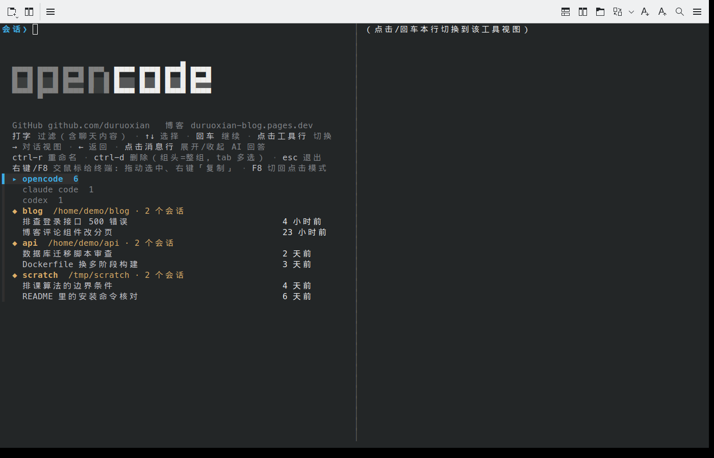
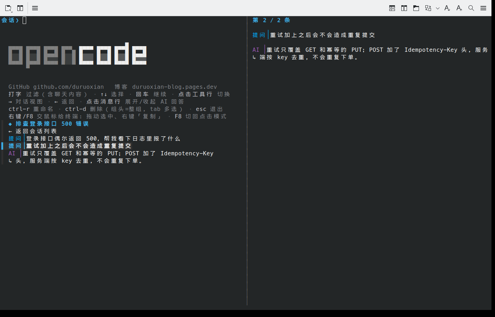

# ocs 🗂️

> **Open Coding Sessions** — history sessions for opencode / claude code / codex, as easy to find as ZCode 🦜
> Browse, search, and jump back in — a single-file Python terminal TUI, zero third-party dependencies.

English | [简体中文](README.zh-CN.md)



## Why 👀

The three coding CLIs — **opencode**, **claude code**, **codex** — each make their past
sessions painfully hard to find: official commands only show the current directory, or just
an ID and a title. Getting back to something you discussed days ago means digging through memory.

ocs gives all of them the ZCode experience:

- 🗂️ **Single-tool view**: the facade shows only the current tool's logo and its sessions
  (grouped by directory, newest first within each group)
- 🔀 **Clickable tool rows**: three rows at the top of the list — click or press Enter to
  switch between the three tools; your last choice is remembered. Uninstalled tools are
  still switchable (they just say "no sessions yet")
- 🔍 **Fuzzy search**: not just titles — the **full conversation content** is searchable
  (find an English-titled session with a Chinese keyword)
- 👁️ **Live preview**: session details plus every question you asked, on the right, as you move
- 💬 **Conversation view**: shows only your questions; click one to expand its AI answer, click again to collapse
- ⏎ **Jump back in**: Enter resumes the session (in its original directory); when the CLI
  exits you're back in the list to pick the next one
- 🧹 Housekeeping: rename (opencode), bulk delete, fork & resume, `ctrl-y` to copy a session ID



## Dependencies 🧩

| What | Notes |
|---|---|
| Python 3.8+ | Standard library only, no pip dependencies |
| [fzf](https://github.com/junegunn/fzf) ≥ 0.68 | The UI (`--wrap=word` needs ≥ 0.68; also uses `--info-command`, `execute`/`reload`, `--track`) |
| opencode / claude code / codex | The data sources — **you only get what you have installed** (`~/.local/share/opencode/`, `~/.claude/`, `~/.codex/`) |
| Terminal | Any modern terminal on Linux (best mouse/copy experience on **Konsole**); macOS Terminal.app / iTerm2; Windows Terminal |

## Install 📦

### Linux / macOS

```bash
git clone https://github.com/duruoxian/ocs.git
cd ocs
./install.sh          # installs to ~/.local/bin/ocs and wires up your shell PATH
```

On macOS the only extra step is `brew install fzf` (the clipboard uses the built-in
`pbcopy`; the OSC background-color probe works natively).

### Windows (PowerShell) 🪟

Windows runs the same `ocs` Python script through a thin `ocs.ps1` launcher:

```powershell
winget install Python.Python.3.12     # if you don't have Python yet
winget install junegunn.fzf
cd ocs
./install.ps1
```

Windows differences: select text by **dragging and right-click → Copy** directly (no F8
hand-off needed); `ctrl-y` goes through `clip`; clicking a tool row switches the list
immediately while the logo updates after a restart.

## Usage ⌨️

```bash
ocs        # open the session list (this is the everyday command)
ocs -h     # full help / tutorial
```

Keys:

| Key | Effect |
|---|---|
| Type | Filter (searches titles **and** conversation content) |
| `↑` `↓` | Move; live preview on the right |
| Click/Enter a tool row | Switch opencode / claude code / codex (last choice remembered) |
| `Enter` / double-click | Resume the selected session; back to the list when it exits |
| `→` / `←` | Open / leave the conversation view (click a question row to expand/collapse its answer) |
| `ctrl-r` | Rename session (opencode) |
| `ctrl-d` | Delete (on a group header = the whole group; `tab` multi-select = bulk delete) |
| `ctrl-e` | Fork & resume a copy (opencode) |
| `ctrl-y` | Copy the session ID to the clipboard |
| `Right-click` / `F8` | Hand the mouse to the terminal (drag to select, right-click to copy); `F8` to switch back |
| `esc` | Quit |

Command line:

```bash
ocs -p /path/dir     # only sessions under this directory (subdirectories included)
ocs --last [N]       # resume the Nth most recent session without opening the list
ocs --show ID        # inspect a session in the terminal (oc:/cc:/cx: prefixes; id prefixes work)
ocs --delete ID...   # delete sessions (confirmation first)
ocs -l               # plain-text list (for pipes/scripts)
```

## Under the hood 🔧

- **Data**: opencode is read straight from its SQLite database (WAL, read-only — running
  opencode is never disturbed); claude code / codex sessions are parsed from their JSONL
  files (mtime+size cache, broken lines/files skipped); rename/delete for opencode goes
  through its official CLI, the other two delete their session files (with a realpath guard
  confined to each tool's own directory)
- **UI**: a single fzf instance with `execute`/`reload` — everything happens inside the
  interface; `--track` keeps the cursor stable across refreshes; the logo facade lives in
  the fzf header, so switching tools simply restarts fzf
- **Logos**: opencode's official pixel wordmark (background adapts to your terminal via an
  OSC 11 probe) plus the official Claude / OpenAI brand marks (baked from Wikimedia SVGs) —
  all three normalized to 8 rows
- **Colors**: amber group headers, truecolor grays — and deliberately no cyan (some terminal
  themes render it as a blinding green)
- **Testing**: interactions and mouse flows are regression-tested with real events in an
  isolated Xvfb environment

More day-to-day details in the [tutorial](TUTORIAL.md) (中文版见 [使用教程](TUTORIAL.zh-CN.md))。

## License

MIT ♥️
